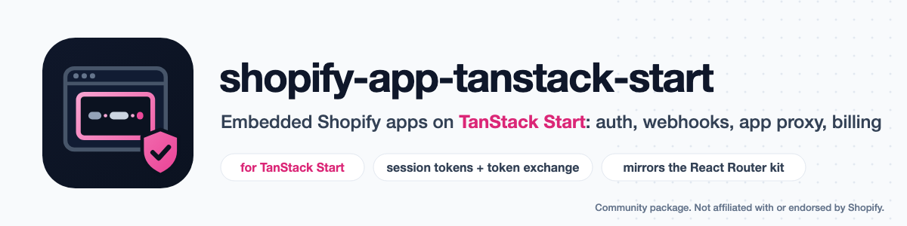

<p align="center">
  <picture>
    <source media="(prefers-color-scheme: dark)" srcset="art/banner-dark.png">
    
  </picture>
</p>

# shopify-app-tanstack-start: build Shopify apps on TanStack Start

Build **embedded Shopify apps on TanStack Start**: session tokens and token exchange, App Bridge, webhook and app proxy verification, the mandatory compliance webhooks and the Billing API, as TanStack Start middleware, server functions and server routes. It gives Start apps the server API of `@shopify/shopify-app-react-router` (`shopifyApp()`, `authenticate.admin`, `authenticate.webhook`, `authenticate.public.appProxy`, `billing`, `unauthenticated.admin`, ...), built on Shopify's `@shopify/shopify-api`.

> Community package by Amjad Iqbal. **Not affiliated with, endorsed by or supported by Shopify.** Its server core is adapted from Shopify's MIT-licensed `@shopify/shopify-app-react-router` (see [Credits](#credits)).

[](https://www.npmjs.com/package/@amjadiqbal/shopify-app-tanstack-start)
[](package.json)
[](LICENSE.md)

```ts
// A server function in an embedded admin page: the session token is checked and exchanged for you.
export const loadProducts = createServerFn()
  .middleware([shopifyAdmin])
  .handler(async ({ context: { admin, session } }) => {
    const response = await admin.graphql(`{ products(first: 5) { nodes { id title } } }`)
    return (await response.json()).data.products.nodes
  })
```

## Why

Shopify's app packages exist for React Router, Remix and Express. Apps on TanStack Start have had to copy auth, webhook and billing code out of boilerplate repos. This package is that code as a library, kept close to Shopify's own implementation so it behaves like the React Router template:

- **Embedded auth with session tokens**: the `id_token` on page loads and the `Authorization: Bearer` header on server function calls, the session token bounce page, token exchange for offline (and optionally online) access tokens, the `afterAuth` hook, and the 401 retry and reauthorize headers App Bridge acts on.
- **Webhooks**: HMAC verification, typed topics, and a ready handler for the three mandatory compliance topics. It answers 401 to a bad HMAC, 400 to a body that is not JSON, 500 when your handler or the session cleanup fails (so Shopify retries), and deletes a shop's sessions on `shop/redact` and `app/uninstalled`.
- **App proxy**: signature and timestamp checks (done by `@shopify/shopify-api`, which rejects timestamps more than 90 seconds away from the server's clock, in either direction), a session and Admin/Storefront clients for the shop, and `liquid()` responses.
- **Billing**: `require`, `check`, `request`, `cancel`, usage records and capped amounts. The confirmation page opens at the top level, whether billing runs while a page renders or in a server function called from the browser.
- **The rest of the React Router server package**: `authenticate.flow`, `fulfillmentService`, `pos`, `public.checkout`, `public.customerAccount`, `unauthenticated.admin` and `storefront`, `registerWebhooks`, `login`, `scopes`, merchant custom apps (`AppDistribution.ShopifyAdmin`), and any `@shopify/shopify-app-session-storage-*` adapter (only the SQLite and memory adapters have been tried; see [What's tested](#whats-tested)).
- **TanStack Start glue**: request and function middleware bodies, an auth route handler, Shopify's `Content-Security-Policy: frame-ancestors` and preload headers on app pages ([details](#how-it-fits-tanstack-start)), Responses converted to router redirects where Start needs them, and an `AppProvider` that routes App Bridge navigation through TanStack Router.

## Install

```bash
npm i @amjadiqbal/shopify-app-tanstack-start
```

Add a session storage adapter, for example `@shopify/shopify-app-session-storage-prisma`, `-drizzle`, `-sqlite`, `-redis`, or `-memory` for development. Any `SessionStorage` implementation is accepted, but only `-sqlite` and `-memory` have been tested with this package so far. Peer dependencies: `@tanstack/react-start` ^1.168, `@tanstack/react-router` ^1.170, React 18 or 19. Node 22.12 or later.

## Scope

- **Embedded apps only.** Apps are always embedded in the Shopify admin. The `isEmbeddedApp` option is not accepted: passing it at all, `true` or `false`, throws.
- **Token exchange, not the OAuth authorization-code flow.** App Store and single-merchant apps rely on Shopify-managed installation (`use_legacy_install_flow = false`) and exchange the session token for an access token. There is no `/auth/callback` handler. Merchant custom apps (`distribution: AppDistribution.ShopifyAdmin`) use the `adminApiAccessToken` you configure instead.
- **`login()`** validates the shop domain from a login form and redirects to that store's install page (`https://admin.shopify.com/store/<store>/oauth/install?client_id=...`), where Shopify's managed installation takes over. `login()` exists only for App Store and single-merchant apps; merchant custom apps (`AppDistribution.ShopifyAdmin`) have no `login()`.

## Set up an embedded app

The steps assume the TanStack Start file layout (`src/routes`, `src/start.ts`): six small files.

### 1. Environment and `shopify.app.toml`

The Shopify CLI provides `SHOPIFY_API_KEY`, `SHOPIFY_API_SECRET`, `SHOPIFY_APP_URL` and `SCOPES` to your dev server. For the browser, also expose the client ID (it is public) as `VITE_SHOPIFY_API_KEY`.

```toml
# shopify.app.toml: the parts this package relies on
application_url = "https://your-app.example.com"
embedded = true

[access_scopes]
scopes = "read_products"
use_legacy_install_flow = false   # Shopify-managed installation, then token exchange

[webhooks]
api_version = "2026-07"

  [[webhooks.subscriptions]]
  compliance_topics = ["customers/data_request", "customers/redact", "shop/redact"]
  uri = "/webhooks/compliance"

  [[webhooks.subscriptions]]
  topics = ["app/uninstalled"]
  uri = "/webhooks/compliance"
```

### 2. `src/shopify.server.ts`

```ts
import { ApiVersion, shopifyApp } from '@amjadiqbal/shopify-app-tanstack-start/server'
import { PrismaSessionStorage } from '@shopify/shopify-app-session-storage-prisma'
import { prisma } from './db.server'

export const shopify = shopifyApp({
  apiKey: process.env.SHOPIFY_API_KEY!,
  apiSecretKey: process.env.SHOPIFY_API_SECRET!,
  appUrl: process.env.SHOPIFY_APP_URL!,
  scopes: process.env.SCOPES?.split(','),
  apiVersion: ApiVersion.July26,
  sessionStorage: new PrismaSessionStorage(prisma),
  hooks: {
    afterAuth: async ({ session, admin }) => {
      // Runs after a token exchange: seed shop data, register webhooks, ...
    },
  },
})
```

The options are those of `@shopify/shopify-app-react-router`'s `shopifyApp()`: `billing`, `webhooks`, `useOnlineTokens`, `distribution`, `authPathPrefix`, `future`, `logger`, `customShopDomains`, ...

### 3. `src/shopify.middleware.ts`

TanStack Start strips server code from the browser bundle only for `createMiddleware()` calls written in your app. So the package gives you each middleware's body, and you wrap it in one line:

```ts
import { createMiddleware } from '@tanstack/react-start'
import { shopify } from './shopify.server'

// Global: every app page gets Shopify's frame-ancestors headers and is authenticated.
export const shopifyDocument = createMiddleware().server(async (ctx) =>
  ctx.next({ context: await shopify.middleware.document(ctx, { exclude: ['/api', '/public'] }) }),
)

// Server functions: context gets admin, session, billing, redirect, scopes, cors, sessionToken.
export const shopifyAdmin = createMiddleware({ type: 'function' }).server(async (ctx) =>
  ctx.next({ context: await shopify.middleware.admin(ctx) }),
)

// Server routes: context.webhook and context.appProxy.
export const shopifyWebhook = createMiddleware().server(async (ctx) =>
  ctx.next({ context: await shopify.middleware.webhook(ctx) }),
)
export const shopifyAppProxy = createMiddleware().server(async (ctx) =>
  ctx.next({ context: await shopify.middleware.appProxy(ctx) }),
)
```

### 4. `src/start.ts`

```ts
import { createCsrfMiddleware, createStart } from '@tanstack/react-start'
import { shopifyDocument } from './shopify.middleware'

// Listing your own request middleware drops Start's default CSRF check for server functions. Without this line a
// cross-site POST that carries a valid session token is accepted; with it, it gets 403.
const csrfMiddleware = createCsrfMiddleware({ filter: (ctx) => ctx.handlerType === 'serverFn' })

export const startInstance = createStart(() => ({ requestMiddleware: [csrfMiddleware, shopifyDocument] }))
```

### 5. `src/routes/auth/$.ts`

Serves the session token bounce page and the exit-iframe page (billing confirmation, leaving the admin frame).

```ts
import { createFileRoute } from '@tanstack/react-router'
import { shopify } from '../../shopify.server'

export const Route = createFileRoute('/auth/$')({
  server: { handlers: { GET: ({ request }) => shopify.authRouteHandler(request) } },
})
```

### 6. `src/routes/__root.tsx`

```tsx
import { AppProvider, appBridgeHead } from '@amjadiqbal/shopify-app-tanstack-start/react'
import { HeadContent, Outlet, Scripts, createRootRoute } from '@tanstack/react-router'
import { createServerFn } from '@tanstack/react-start'
import { shopifyAdmin } from '../shopify.middleware'

const loadShop = createServerFn()
  .middleware([shopifyAdmin])
  .handler(({ context }) => ({ shop: context.session.shop }))

const appBridge = appBridgeHead({ apiKey: import.meta.env.VITE_SHOPIFY_API_KEY })

export const Route = createRootRoute({
  loader: () => loadShop(),
  head: () => ({ meta: [{ charSet: 'utf-8' }, ...appBridge.meta], scripts: appBridge.scripts }),
  shellComponent: ({ children }) => (
    <html lang="en">
      <head><HeadContent /></head>
      <body>{children}<Scripts /></body>
    </html>
  ),
  component: () => (
    <AppProvider>
      <s-app-nav>
        <a href="/" rel="home">Home</a>
        <a href="/products">Products</a>
      </s-app-nav>
      <Outlet />
    </AppProvider>
  ),
})
```

For TypeScript to accept `<s-app-nav>` and other App Bridge elements, install `@shopify/app-bridge-types` as a dev dependency and add this file. App Bridge declares its elements on the global `JSX` namespace, but React 19 reads `React.JSX`:

```ts
// src/app-bridge-jsx.d.ts
import type { SAppNavAttributes } from '@shopify/app-bridge-types'

declare module 'react' {
  namespace JSX {
    interface IntrinsicElements {
      's-app-nav': SAppNavAttributes
    }
  }
}
```

`appBridgeHead()` adds the `shopify-api-key` meta tag and loads App Bridge (and Polaris web components, unless `polaris: false`) from Shopify's CDN in the document head, before your app's scripts, as App Bridge requires. `AppProvider` turns App Bridge navigation (`<s-app-nav>` links and the like) into TanStack Router navigation instead of iframe reloads.

## How it fits TanStack Start

| Request | What handles it |
|---|---|
| Admin page load (`?embedded=1&shop&host&id_token`) | `middleware.document` validates the session token, loads or exchanges the session and sets `frame-ancestors`. Server functions called while the page renders reuse that result instead of authenticating again. |
| Page load without a session token | `middleware.document` answers with the redirect to `/auth/session-token` (bounce page), the redirect into the Shopify admin, or the App Bridge page, as the React Router package does. |
| Server function called from the browser | App Bridge adds `Authorization: Bearer <session token>` to same-origin `fetch`, and `middleware.admin` validates it. An invalid or expired token gets a 401 with `X-Shopify-Retry-Invalid-Session-Request`, and App Bridge retries with a fresh token. |
| `billing.request()` or `redirect()` in a server function | While a page renders, the Response becomes a router redirect (billing goes through `/auth/exit-iframe`, which opens the confirmation page at the top level). Called from the browser, it is a 401 with `X-Shopify-API-Request-Failure-Reauthorize-Url`, which App Bridge follows. |
| Webhooks, app proxy | Server routes with the `shopifyWebhook` or `shopifyAppProxy` middleware, or `shopify.authenticate.webhook(request)` and `shopify.authenticate.public.appProxy(request)` in a handler. |

`middleware.document` treats every GET and HEAD page request as part of the embedded app. Pass `exclude` (path prefixes or RegExps) for public pages and for GET server routes that are not admin pages. It also skips the auth path, and requests that carry app proxy parameters (both `signature` and `path_prefix`). It only checks that those parameters are present: their signature is checked by the app proxy middleware, so serve app proxy paths with `shopifyAppProxy` (or `authenticate.public.appProxy`). A page reached with fake proxy parameters still gets no admin data, because `middleware.admin` authenticates every server function on its own.

Headers it sets on the pages it handles, as Shopify's React Router package does:

- With a valid `shop` parameter: `Content-Security-Policy: frame-ancestors https://<shop> https://admin.shopify.com ...` and a `Link` header that preloads App Bridge and Polaris.
- Without a valid `shop` parameter: no `frame-ancestors` or `Link` header.
- Merchant custom apps (`AppDistribution.ShopifyAdmin`): `frame-ancestors 'none'`.
- Excluded paths, the auth path, app proxy requests and server function calls: none.

The auth route answers `204 No Content` when a request there has nothing to render (no bounce or exit-iframe page). If authentication answers with anything other than a redirect while a page server-renders, `middleware.admin` throws a `ShopifyResponseError` naming the page and status, for your error boundary.

## Webhooks

```ts
// src/routes/webhooks/compliance.ts: the three mandatory compliance topics, plus app/uninstalled
export const Route = createFileRoute('/webhooks/compliance')({
  server: {
    handlers: {
      POST: ({ request }) =>
        shopify.complianceWebhooks({
          customersDataRequest: async ({ shop, payload }) => queue.add('export-customer', { shop, payload }),
          customersRedact: async ({ shop, payload }) => queue.add('redact-customer', { shop, payload }),
          shopRedact: async ({ shop }) => db.shop.delete({ where: { domain: shop } }),
        })(request),
    },
  },
})
```

```ts
// src/routes/webhooks/products.ts: any other topic
export const Route = createFileRoute('/webhooks/products')({
  server: {
    middleware: [shopifyWebhook],
    handlers: {
      POST: async ({ context: { webhook } }) => {
        // webhook.topic === 'PRODUCTS_UPDATE'; webhook.shop, webhook.payload, webhook.admin (when a session exists)
        return new Response()
      },
    },
  },
})
```

`complianceWebhooks()` answers 401 to a bad HMAC (Shopify's compliance check expects that), 400 when the HMAC header, other required Shopify headers or the body are missing, or when the signed body is not JSON, 405 to anything but POST, and 200 once your handler finishes. It deletes the shop's stored sessions on `shop/redact` and `app/uninstalled`. If your handler throws, or deleting the sessions fails, it calls `onError` (default `console.error`) and answers 500 so Shopify retries; when your handler is the one that failed, the sessions are left in place. If `onError` itself throws, that error is logged with `console.error` and the answer is still 500. Do slow work in a queue, because Shopify retries a webhook that takes more than 5 seconds.

## App proxy

```ts
// src/routes/proxy/$.ts, with [app_proxy] url = "https://your-app.example.com/proxy" in shopify.app.toml
export const Route = createFileRoute('/proxy/$')({
  server: {
    middleware: [shopifyAppProxy],
    handlers: {
      GET: ({ context: { appProxy } }) => appProxy.liquid('<p>Hello {{ shop.name }}</p>'),
    },
  },
})
```

## Billing

```ts
const requirePro = createServerFn()
  .middleware([shopifyAdmin])
  .handler(async ({ context: { billing } }) => {
    await billing.require({
      plans: ['Pro'],
      onFailure: () => billing.request({ plan: 'Pro' }),
    })
  })

export const Route = createFileRoute('/settings')({ loader: () => requirePro() })
```

Declare plans in `shopifyApp({ billing: { Pro: { lineItems: [...] } } })`, as in the React Router package.

## Migrating from `@shopify/shopify-app-react-router`

| React Router | TanStack Start |
|---|---|
| `shopifyApp` from `@shopify/shopify-app-react-router/server` | `shopifyApp` from `@amjadiqbal/shopify-app-tanstack-start/server`, same options |
| `await authenticate.admin(request)` in a loader or action | `.middleware([shopifyAdmin])` on a server function, then `context.admin`, `context.billing`, ... |
| `app/routes/auth.$.tsx` loader | `src/routes/auth/$.ts` with `shopify.authRouteHandler(request)` |
| `addDocumentResponseHeaders` in `entry.server.tsx` | done by `middleware.document` |
| `boundary.error` and `boundary.headers` | not needed; Responses are converted for Start (see above) |
| `<AppProvider embedded apiKey>` from `/react` | `appBridgeHead()` in the root `head()`, plus `<AppProvider>` |
| `authenticate.webhook(request)` in an action | the same call in a server route `POST` handler, or the `shopifyWebhook` middleware |

Not ported: the React Router error boundary, `AppProxyProvider` and `AppProxyLink`, and the `/test-helpers` entry.

## What's tested

- **408 unit tests, all passing.** 367 are Shopify's own tests for the React Router package's server code, ported to Vitest and run against this package's core: token exchange, bounce and exit-iframe pages, bot rejection, billing, scopes, webhooks, app proxy, checkout, customer account, POS, Flow, fulfillment service, unauthenticated contexts and token refresh. 41 are new tests for the Start layer, including type tests that check the middleware context types reach `createServerFn().handler()` and server route handlers with the real `@tanstack/react-start` types.
- **A real TanStack Start app** (Start 1.169, Router 1.170, React 19, Vite 8, Node 26) that installs the packed tarball and uses a SQLite session store, checked in the browser and with curl. Shopify itself was simulated: session tokens signed with the app secret, webhook and app proxy HMACs computed as Shopify computes them, the Admin API (token exchange and GraphQL) faked on the server's `fetch`, and a small stand-in for App Bridge that adds the bearer token, retries on the 401 retry header and dispatches `shopify:navigate`. Seen working:
  - embedded page load with token exchange, the offline session stored in SQLite, `afterAuth` run once, and server functions reusing the page's authentication during server rendering;
  - the bounce redirect, the redirect into the admin, the App Bridge page outside the admin, the exit-iframe page and its refusal of a foreign destination;
  - server functions called from the browser, an expired token answered with 401 and retried, and `<s-app-nav>` navigation without page reloads;
  - billing from a page load (through exit-iframe) and from the browser (reauthorize header);
  - compliance webhooks (200, and 401 on a bad HMAC), the webhook middleware, app proxy `liquid()` (and 400 on a bad signature), bot user agents (410), `frame-ancestors` and preload headers, and a production build served with `vite preview`.
- **CSRF with the README setup**: in the test app, a cross-site POST to a server function with a valid session token got 403 with `createCsrfMiddleware` registered, and 200 without it; same-origin calls got 200.
- **Covered only by the ported unit tests**, not tried in the test app: `authenticate.flow`, `pos`, `fulfillmentService`, `public.checkout`, `public.customerAccount`, and merchant custom apps (`AppDistribution.ShopifyAdmin`).
- **The React entry (`appBridgeHead`, `AppProvider`) has no unit tests.** It was checked in the test app: the head tags in the production HTML, and `AppProvider` turning App Bridge stand-in navigation events into router navigation.
- **Not tested against a live Shopify store yet**: a real development store, the Shopify CLI (`shopify app dev`), the real App Bridge inside the admin iframe, real Admin GraphQL responses, and session adapters other than SQLite and memory. Please open an issue if anything behaves differently on a live store.

## Credits

The server core (`src/core`) is adapted from Shopify's [`@shopify/shopify-app-react-router`](https://github.com/Shopify/shopify-app-js/tree/main/packages/apps/shopify-app-react-router) 4.0.0 (MIT licence, © Shopify Inc.) with React Router removed. The changes are listed in [`src/core/README.md`](src/core/README.md), and Shopify's licence is included in [LICENSE.md](LICENSE.md). It runs on Shopify's [`@shopify/shopify-api`](https://github.com/Shopify/shopify-app-js/tree/main/packages/apps/shopify-api). Shopify is a trademark of Shopify Inc. This package is not affiliated with or endorsed by Shopify.

## Support

- 🐛 **Bug or feature request**: [open an issue](https://github.com/amjadiqbal/shopify-app-tanstack-start/issues)
- 🔒 **Security issue**: please report privately via GitHub's security tab

## Need this built into your app, or something custom?

[Get in touch](https://amjad.com.pk/contact?utm_source=github&utm_medium=readme&utm_campaign=shopify-app-tanstack-start).

[](https://www.upwork.com/freelancers/amjadkhatri)

## More packages

Part of a family of open-source packages. See [all of them](https://github.com/amjadiqbal?tab=repositories).

| | |
|---|---|
| [start-seo-kit](https://github.com/amjadiqbal/start-seo-kit) | SEO for TanStack Start: meta tags, sitemaps, JSON-LD |
| [tanstack-table-url-state](https://github.com/amjadiqbal/tanstack-table-url-state) | URL state and CSV/XLSX export for TanStack Table |
| [query-key-kit](https://github.com/amjadiqbal/query-key-kit) | Typed query keys and invalidation for TanStack Query v5 |
| [tanstack-ai-sdk-bridge](https://github.com/amjadiqbal/tanstack-ai-sdk-bridge) | Any Vercel AI SDK provider as a TanStack AI adapter |

## License

MIT. See [LICENSE.md](LICENSE.md).
